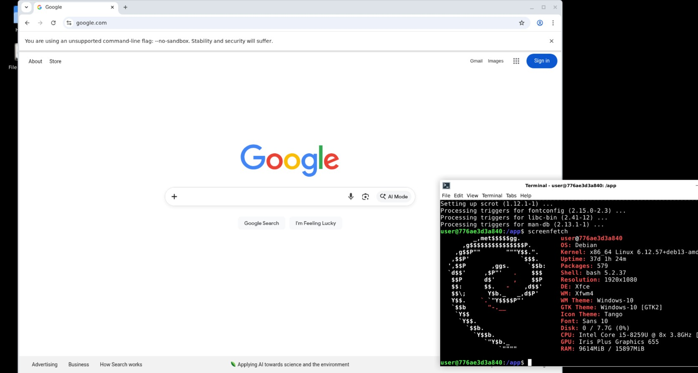

# Chrome Live



Run a containerized Google Chrome on Linux, accessible from any web browser.

Try using Docker:

```
docker run --name chrome-live -p 7000:80 ghcr.io/remotebrowser/chrome-live
```

or Podman:

```
podman run --name chrome-live -p 7000:80 ghcr.io/remotebrowser/chrome-live
```

Then open `localhost:7000` in your browser.

To enable remote control of Chrome via the [Chrome DevTools Protocol](https://chromedevtools.github.io/devtools-protocol/), map port 9222 as well:

```
podman run --name chrome-live -p 7000:80 -p 9222:9222 ghcr.io/remotebrowser/chrome-live
```

Configure Chrome's proxy connection using [Tinyproxy](https://tinyproxy.github.io) (refer to the sample `tinyproxy.conf`).

To allow specific domains, add them to `allowlist.txt` (one domain per line).

To test the CDP connection:

```
curl http://127.0.0.1:9222/json/list
```

To build and run locally:

```
docker build -t chrome-live .
docker run -p 7000:80 chrome-live
```

To deploy to [Fly.io](https://fly.io)

```
fly apps create test-chrome-live
fly deploy --ha=false -a test-chrome-live

# test CDP connection
FLY_IP=$(fly ips list -a test-chrome-live --json | jq -r '.[] | select(.Type=="v4") | .Address')
curl http://$FLY_IP:9222/json/list
```

## Telemetry (OpenTelemetry collector sidecar)

`browser-trace` sends its logs over OTLP to a local [OpenTelemetry Collector](https://opentelemetry.io/docs/collector/)
(`otelcol`, an s6 service listening on `127.0.0.1:4318`). The collector sends a full copy of
every signal to each backend that is configured (dual-write):

| Env var                    | Backend                                                                        |
| -------------------------- | ------------------------------------------------------------------------------ |
| `LOGFIRE_TOKEN`            | Pydantic Logfire (region picked from the token)                                |
| `OTLP_DUAL_WRITE_ENDPOINT` | Any OTLP/HTTP backend, e.g. `https://otlp.example.com`                         |
| `OTLP_DUAL_WRITE_HEADERS`  | Headers for that backend, `k1=v1,k2=v2` (`%20` is decoded to a space)          |

With neither set, the collector drops the data. Backends are read at container start; restart
to change them.

```
docker run -p 7000:80 \
  -e LOGFIRE_TOKEN=pylf_v1_us_... \
  -e OTLP_DUAL_WRITE_ENDPOINT=https://otlp-gateway.example.com/otlp \
  -e OTLP_DUAL_WRITE_HEADERS="Authorization=Basic%20xxxx" \
  chrome-live
```

## Stealth browser (CloakBrowser / custom-chromium)

The image ships [CloakBrowser](https://pypi.org/project/cloakbrowser/) — a stealth
Chromium build — alongside Google Chrome. Chrome is the default. All serve CDP on the
same internal port (`:9221`), so browser-trace and the `:9222` proxy work identically
regardless of which is active.

> The base image builds for both `linux/amd64` and `linux/arm64`. CloakBrowser and
> `custom-chrome` are both **amd64 only** — CloakBrowser publishes no arm64 binary, and
> the `custom-chrome` build used here targets amd64 (matching Daytona's host arch). On
> arm64 only Google Chrome is available (no `switch-browser cloak` or `custom`).

Switch at runtime (e.g. over ssh into the container):

```
switch-browser cloak    # kill Chrome, launch CloakBrowser (amd64 only)
switch-browser custom   # switch to custom-chrome (amd64 only)
switch-browser chrome   # switch back
```

The choice persists in `/home/user/.active-browser` and the `chromium` service restarts on
the same CDP endpoint.

## Daytona backend

The same image also runs on Daytona (a sandbox reached via a Daytona signed preview URL to
CDP on `:9222`); `start-init.sh` auto-detects Daytona/Fly vs. a plain Docker host at boot.
See [daytona/README.md](daytona/README.md).

## Provider startup benchmarks

Measured cold-boot and resume latency for chrome-live on several hosting
providers, with a recommendation for which orchestration approach (direct spawn
vs pre-warmed pool) fits each.

- Aggregated results and ranking: [bench/REPORT.md](bench/REPORT.md)
- Harness layout, credentials, and reproduction steps: [bench/README.md](bench/README.md)
